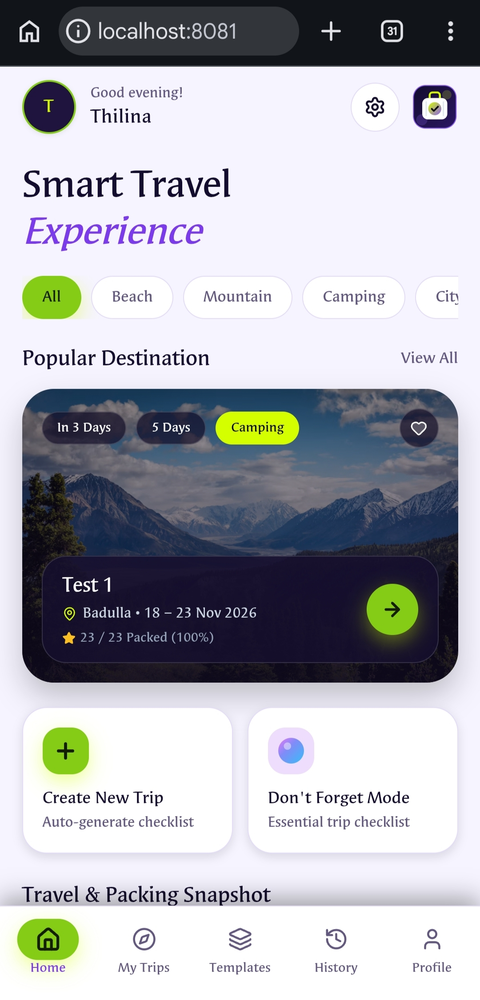
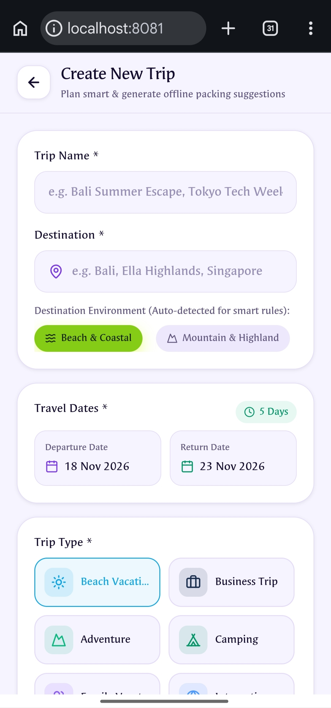
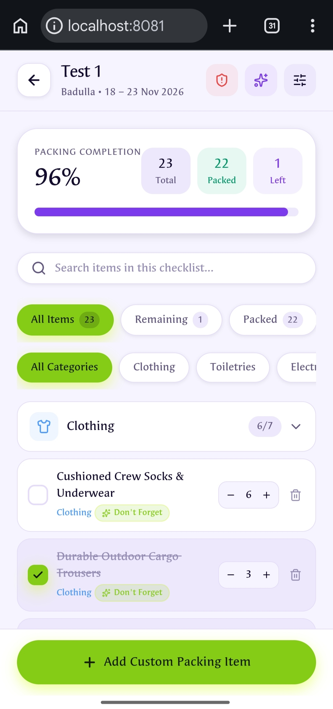
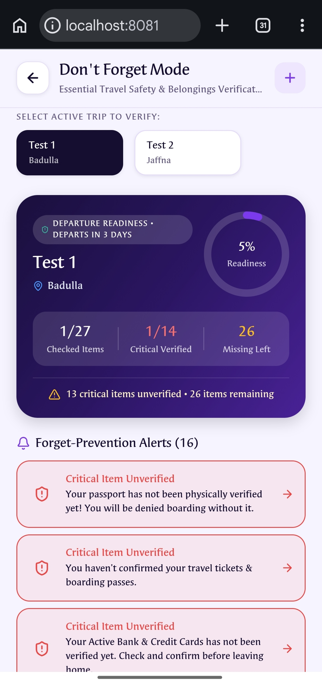
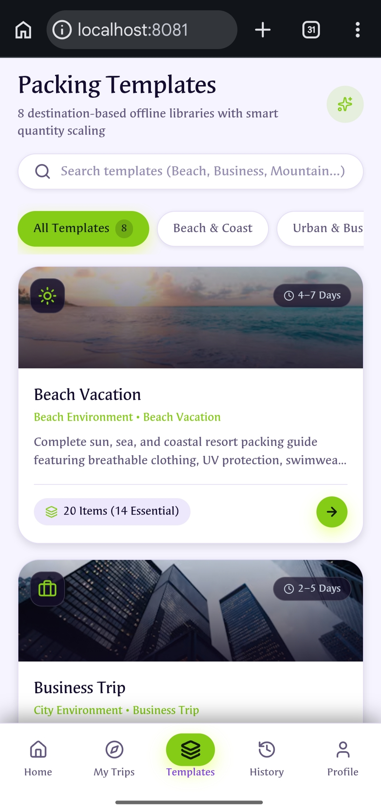
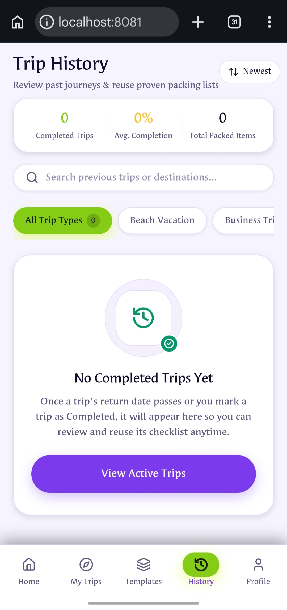
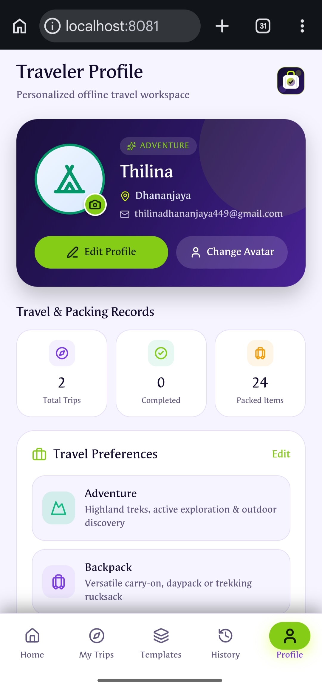
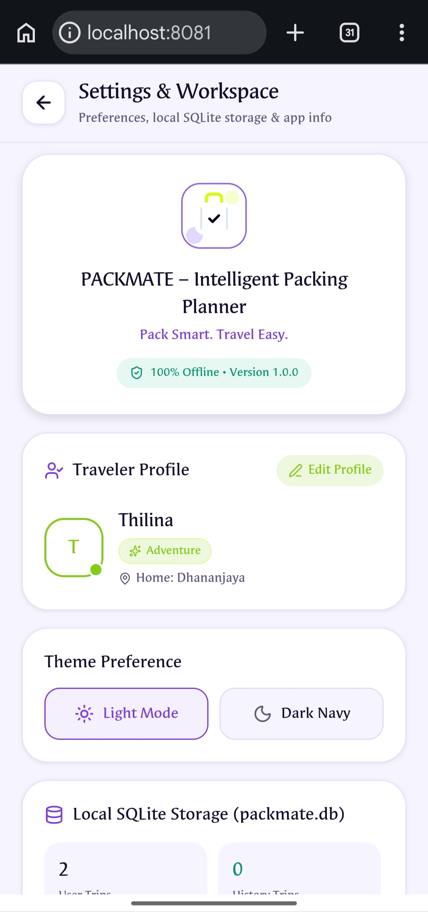
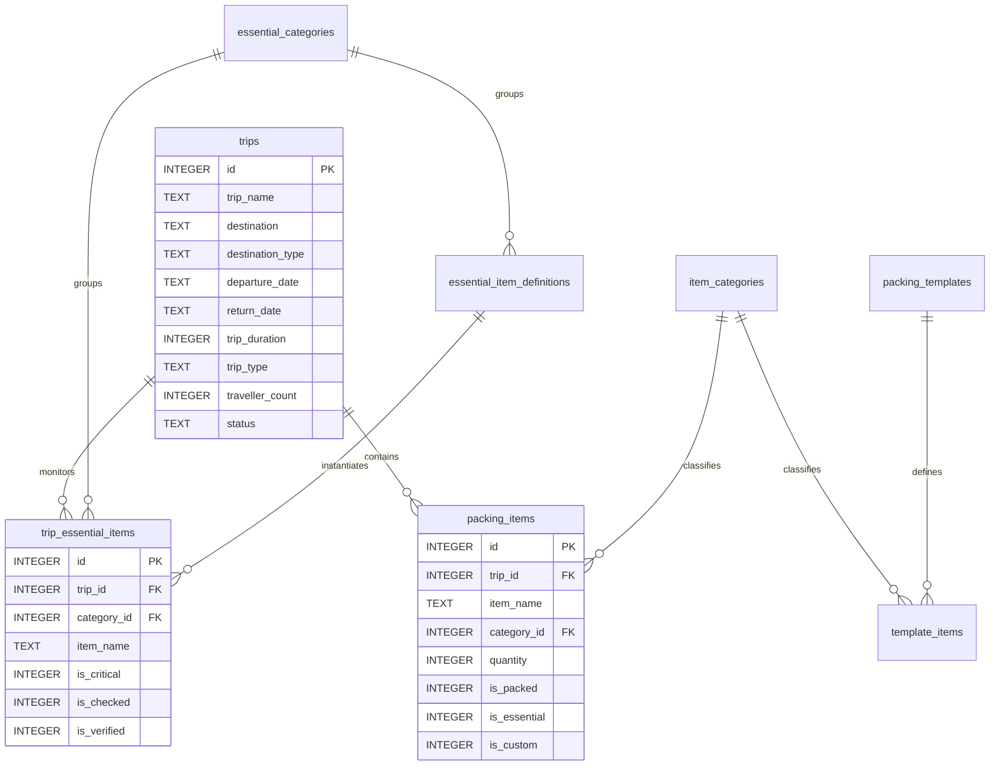

# PACKMATE – Intelligent Packing Planner

<div align="center">

  

  <h3>Pack Smart. Travel Easy.</h3>
  <p><em>Make every journey stress-free, organized, and unforgettable.</em></p>

  <p>
    <a href="https://github.com/Thilina-dhananjaya911/Packmate"></a>
    
    
    
    
  </p>

</div>

---

## Table of Contents

- [Project Overview](#project-overview)
- [Key Features](#key-features)
- [Application Screenshots](#application-screenshots)
- [Technologies Used](#technologies-used)
- [Installation and Setup](#installation-and-setup)
- [How to Run the Application](#how-to-run-the-application)
- [Offline Functionality & Privacy](#offline-functionality--privacy)
- [Project Structure](#project-structure)
- [Database Architecture](#database-architecture)
- [Author Information](#author-information)
- [Future Improvements](#future-improvements)

---

## Project Overview

**PACKMATE** is an offline-first, production-grade mobile packing assistant built with **React Native**, **Expo (SDK 58)**, **TypeScript**, and **Expo SQLite**. Developed as an individual academic mobile application project, PACKMATE is engineered to eliminate the stress, cognitive overload, and common mistakes associated with travel preparation.

### The Problem
Travelers frequently experience:
- **Last-minute packing anxiety**: Packing in a rush leads to disorganization and elevated stress before departure.
- **Forgotten critical essentials**: Overlooking vital belongings—such as passports, prescription medications, boarding passes, or charging adapters—can disrupt or halt an entire journey.
- **Overpacking or underpacking**: Without duration-scaled item quantities and climate awareness, travelers struggle to calculate suitable clothing and supplies.
- **Unreliable connectivity during transit**: Cloud-reliant travel apps fail when travelers enter flight mode, remote wilderness areas, or foreign destinations without active cellular roaming.

### The PACKMATE Solution
PACKMATE operates **100% offline**, housing a local relational SQLite database and an intelligent recommendation engine directly on the device. It provides:
1. **Intelligent Offline Recommendations**: Context-aware item suggestions based on destination environment keywords, trip duration, and traveller count.
2. **Pre-built Destination Templates**: 8 curated offline templates containing 158 items across diverse travel styles (Beach, Mountain, Business, Camping, and more).
3. **Structured Item Categorization**: 7 organized categories with live packing progress counters and quantity steppers.
4. **Don't Forget Mode**: A dedicated departure readiness system with critical verification flags and warning alerts for high-stakes travel items.
5. **Zero Cloud Dependencies**: Complete data privacy, zero external servers, and instantaneous responsiveness without network connectivity.

---

## Key Features

### 1. Trip Creation and Lifecycle Management
- **Interactive Trip Setup**: Define trip name, destination, departure and return dates, traveller count, and primary trip type.
- **Automatic Duration Calculation**: Computes the exact number of travel days and automatically scales quantity recommendations.
- **Destination Environment Detection**: Automatically infers climate and terrain attributes (*Beach & Coastal, Mountain & Highland, Urban & Metro, Forest & Wilderness, International Hub, Resort*) from destination keywords.
- **Date-Driven Status Synchronization**: Automatically updates trip states between `Upcoming`, `Ongoing`, and `Completed` based on the local calendar date without altering user checklist data.

### 2. Destination-Based Packing Templates
- **8 Curated Offline Libraries**:
  - *Beach Vacation* (20 curated items: swimwear, UV protection, breathable apparel)
  - *Business Trip* (wrinkle-free formalwear, tech gear, presentation essentials)
  - *Camping* (tent shelter, sleeping pad, camp lighting, insect repellent)
  - *Mountain Adventure* (thermal layers, windproof jackets, trekking gear)
  - *International Travel* (passports, universal power adapters, transit vouchers)
  - *Family Vacation* (multi-traveller care, first aid, entertainment, snacks)
  - *Weekend Getaway* (streamlined carry-on essentials for short 2–3 day getaways)
  - *City Exploration* (daypack, walking footwear, metro travel essentials)
- **158 Built-in Seed Items**: Seeded idempotently on first launch into SQLite, ready for instant offline use.

### 3. Intelligent Offline Recommendation Engine
- **Local Rule Engine**: Generates customized packing lists without requesting remote APIs.
- **Smart Quantity Scaling**: Uses specific scaling rules per item type:
  - `daily`: Scales dynamically with trip days (e.g., daily underwear, t-shirts, capped for practical laundry cycles).
  - `half_days` & `third_days`: Scales proportionally for multi-day usage (e.g., trousers, jackets, resort wear).
  - `weekly`: Scales for extended journeys (e.g., sunscreens, travel toiletries).
  - `fixed`: Remains constant regardless of duration (e.g., passport, house keys, power bank).
- **Traveller Count Multiplier**: Automatically multiplies personal items by the number of travelers while keeping shared items (e.g., first aid kit, charging hub) consolidated.
- **Deduplication & Canonical Keys**: Merges template items with supplementary environmental items without duplicate entries.

### 4. Interactive Packing Checklist
- **Real-Time Packing Completion**: Live calculation of completion percentages, packed items, and remaining items.
- **Smooth Reanimated Interactions**: Haptic-ready visual feedback and animated checkbox toggles.
- **Inline Quantity Steppers**: Increase or decrease item quantities directly within the checklist.
- **Custom Item Creation**: Add custom personal items with custom category assignments and essential flags.
- **Multi-Axis Filtering & Search**: Instant real-time search combined with filter pills for `All`, `Remaining`, `Packed`, and specific categories.

### 5. 7 Structured Item Categories
Items are systematically organized across 7 categories, each with distinct color coding, vector icons, and expandable accordions:
1. **Clothing** (T-shirts, trousers, thermal base layers, swimwear, socks)
2. **Toiletries** (Toothbrush kit, shampoo, reef-safe sunscreen, skincare)
3. **Electronics** (Smartphones, chargers, power banks, universal adapters)
4. **Documents** (Passports, travel tickets, visas, IDs, booking confirmations)
5. **Accessories** (Sunglasses, hats, daypacks, watches, walking footwear)
6. **Travel Essentials** (Wallets, local currency, keys, luggage locks)
7. **Health & Safety** (First-aid kit, prescription medications, mosquito repellent)

### 6. "Don't Forget Mode" & Departure Readiness
- **High-Stakes Verification**: A specialized dashboard that isolates mission-critical travel belongings (passports, boarding tickets, bank cards, house keys, essential medicine).
- **Departure Readiness Score**: A circular progress ring displaying overall departure readiness percentage.
- **Forget-Prevention Alerts**: Visual warning banners highlighting unverified critical items with contextual warnings (e.g., *"Your passport has not been physically verified yet! You will be denied boarding without it."*).
- **Physical Verification Check**: Mark critical belongings as physically inspected and verified prior to departure.

### 7. Trip History & Packing List Reuse
- **Completed Trip Archive**: Automatic archival of concluded journeys.
- **Travel Statistics**: Displays completed trips, average packing completion percentage, and cumulative packed items.
- **Checklist Reuse**: Non-destructively clone proven packing checklists from past trips into newly planned journeys.

### 8. Local Traveler Profile & Workspace Preferences
- **Traveler Profile**: Local profile storing traveler name, hometown, email, customizable explorer avatars, and travel style persona (*Adventure, Business, Leisure*).
- **Luggage Preferences**: Default luggage type (*Backpack, Carry-on, Checked Suitcase*) and weight limits.
- **Theme Preferences**: Toggle between crisp **Light Mode** and deep **Dark Navy** themes.
- **Local Storage Diagnostics**: Live SQLite storage overview showing active database tables and row counts.

---

## Application Screenshots

The following screenshots illustrate the actual user interface and user experience of PACKMATE running in the Expo environment:

<table align="center" width="100%">
  <tr>
    <td align="center" width="50%">
      
      <br /><br />
      <b>1. Home Dashboard &amp; Active Trip Hero</b>
      <p><em>Personalized greeting, trip countdown banner, category quick-filters, popular destinations, and immediate action cards for trip creation and Don't Forget mode.</em></p>
    </td>
    <td align="center" width="50%">
      
      <br /><br />
      <b>2. Interactive Trip Creation</b>
      <p><em>Trip details form featuring destination input, automatic environment detection (Beach &amp; Coastal, Mountain), interactive calendar date selection, and trip style selectors.</em></p>
    </td>
  </tr>
  <tr>
    <td align="center" width="50%">
      
      <br /><br />
      <b>3. Interactive Packing Checklist</b>
      <p><em>Live 96% completion indicator, category filtering tabs, quantity adjustment steppers, Don't Forget tags, strikethrough checked states, and custom item creation button.</em></p>
    </td>
    <td align="center" width="50%">
      
      <br /><br />
      <b>4. Don't Forget Mode (Readiness &amp; Alerts)</b>
      <p><em>High-priority departure readiness ring, critical verification counters, and actionable forget-prevention alerts preventing travelers from leaving behind passports and cards.</em></p>
    </td>
  </tr>
  <tr>
    <td align="center" width="50%">
      
      <br /><br />
      <b>5. Destination Templates Library</b>
      <p><em>8 pre-configured destination-based packing guides with duration recommendations, essential item counts, search, and category filtering chips.</em></p>
    </td>
    <td align="center" width="50%">
      
      <br /><br />
      <b>6. Trip History &amp; Packing Reuse</b>
      <p><em>Past journey archive with average completion rates, packed item metrics, chronological sorting, and the ability to review and reuse previous packing checklists.</em></p>
    </td>
  </tr>
  <tr>
    <td align="center" width="50%">
      
      <br /><br />
      <b>7. Traveler Profile &amp; Preferences</b>
      <p><em>Offline user profile card with avatar customization, travel style indicator (Adventure), total travel stats, and luggage type preferences.</em></p>
    </td>
    <td align="center" width="50%">
      
      <br /><br />
      <b>8. Settings &amp; SQLite Workspace</b>
      <p><em>Application info, 100% offline badge, light/dark theme switcher, and real-time local SQLite storage diagnostics showing active table row counts.</em></p>
    </td>
  </tr>
</table>

---

## Technologies Used

| Technology | Version | Purpose in PACKMATE |
| :--- | :--- | :--- |
| **React Native** | `0.88.1` | Core cross-platform mobile framework providing native UI rendering, gestures, and performance. |
| **Expo** | `~58.0.25` | Modern mobile runtime environment, tooling, and native platform abstraction (Expo SDK 58). |
| **TypeScript** | `~6.0.3` | Type-safe development offering compile-time type verification, strict data models, and refactoring safety. |
| **Expo SQLite** | `~58.0.17` | Local embedded relational database (`packmate.db`) utilizing the asynchronous next-gen API with WAL mode and foreign key constraints. |
| **React Navigation** | `^7.5.1` | Robust navigation architecture combining native stack screens (`@react-navigation/native-stack`) and a custom animated bottom tab bar (`@react-navigation/bottom-tabs`). |
| **React Native Reanimated** | `4.7.1` | 60+ FPS UI animations for progress bars, checklist toggles, tab icon transitions, and interactive cards. |
| **React Native Worklets** | `0.13.0` | High-performance animation runtime backing Reanimated gestures and layout transitions. |
| **React Native Gesture Handler**| `~3.3.0` | Native-driven touch handling for smooth cards, swipe actions, and modal gestures. |
| **Lucide React Native** | `^1.70.0` | Comprehensive, consistent vector iconography used throughout all categories, navigation tabs, and actions. |
| **React Native SVG** | `15.16.0` | Vector rendering for circular progress rings, gauges, custom illustrations, and dynamic status badges. |
| **Expo Linear Gradient** | `~58.0.4` | Aesthetic gradient hero banners, card accents, and elevation highlights in both light and dark themes. |
| **Expo Status Bar** | `~58.0.5` | Dynamic system status bar adaptation responding seamlessly to light and dark theme toggles. |

---

## Installation and Setup

### Prerequisites
Before running the project, verify that your development machine has:
- **Node.js**: `v22.13.0` or `v24.3.0+` (matching Expo SDK 58 engine compatibility)
- **npm**: `v10.x` or `v11.x`
- **Git** installed on your system
- **Expo Go** application installed on your Android device (from Google Play Store), or an Android Studio Emulator / iOS Simulator.

### Step 1: Clone the Repository
Open your terminal and clone the repository:

```bash
git clone https://github.com/Thilina-dhananjaya911/Packmate.git
```

### Step 2: Navigate to Project Directory
```bash
cd Packmate
```

### Step 3: Install Dependencies
Install all required project dependencies:

```bash
npm install
```

---

## How to Run the Application

Start the application by running:

```bash
npx expo start
```

This command starts the Expo development server (Metro Bundler) and displays an interactive QR code in your terminal.

### Running on an Android Device (Recommended)
1. Ensure your physical Android device and development computer are connected to the **same Wi-Fi network**.
2. Open the **Expo Go** app on your Android phone.
3. Scan the **QR code** displayed in your terminal or Metro web interface.
4. PACKMATE will bundle and launch directly on your device with local SQLite persistence enabled.

### Running on an Android Emulator
Launch your Android Virtual Device (AVD) from Android Studio, then press `a` in the terminal where Expo is running.

### Running on Other Platforms
- **iOS Simulator** (macOS only): Press `i` in the terminal.
- **Web Browser**: Press `w` in the terminal to preview in Chrome/Firefox with WebAssembly OPFS SQLite storage.

---

## Offline Functionality & Privacy

PACKMATE is designed from the ground up as a **100% offline-first application**:

1. **Zero Cloud Dependencies**: The application does not communicate with external REST endpoints, GraphQL servers, Firebase, Supabase, or AWS cloud services.
2. **On-Device Data Storage**: All trip details, packing checklists, custom items, verification timestamps, and traveler profiles are stored in an encrypted/private local SQLite database file (`packmate.db`) within the app's sandboxed storage.
3. **Flight-Ready Performance**: Full functionality—including generating recommendations, modifying checklists, and completing departure checks—is available in airplane mode or in remote areas with zero cell coverage.
4. **Data Privacy**: Personal travel plans, destination history, and contact details remain strictly on the traveler's physical device.

---

## Project Structure

A clean, modular architecture separating UI screens, navigation, state management, database queries, and business services:

```text
PACKMATE/
├── screenshot-01-home.jpeg             # Application screenshot: Home screen
├── screenshot-02-create-trip.jpeg      # Application screenshot: Create trip
├── screenshot-03-packing-checklist.jpeg# Application screenshot: Checklist
├── screenshot-04-dont-forget-mode.jpeg # Application screenshot: Don't Forget
├── screenshot-05-templates.jpeg        # Application screenshot: Templates
├── screenshot-06-history.jpeg          # Application screenshot: History
├── screenshot-07-profile.jpeg          # Application screenshot: Profile
├── screenshot-08-settings.jpeg         # Application screenshot: Settings
├── app.json                            # Expo configuration & plugins
├── App.tsx                             # Application root entry
├── index.ts                            # Expo entrypoint
├── metro.config.js                     # Metro bundler configuration
├── package.json                        # Project dependencies and scripts
├── tsconfig.json                       # TypeScript compiler configuration
└── src/
    ├── app/
    │   └── PackmateApp.tsx             # Root app provider shell & navigation mounting
    ├── components/                     # Reusable modular UI components
    │   ├── AddCustomEssentialModal.tsx # Custom essential item creation modal
    │   ├── AnimatedPressableCard.tsx   # Reanimated card with scale feedback
    │   ├── AnimatedProgressBar.tsx     # Animated horizontal progress indicator
    │   ├── AvatarPickerModal.tsx       # Explorer avatar selector modal
    │   ├── Badges.tsx                  # Status and category pill badges
    │   ├── CircularProgressRing.tsx    # SVG circular progress gauge
    │   ├── ConfirmModal.tsx            # Generic action confirmation dialog
    │   ├── CriticalVerifyModal.tsx     # Physical item inspection modal
    │   ├── DatePickerModal.tsx         # Interactive calendar date range picker
    │   ├── DynamicIcon.tsx             # Dynamic Lucide icon resolver
    │   ├── PrimaryButton.tsx           # Standardized CTA button
    │   ├── ScreenHeader.tsx            # Uniform screen header component
    │   └── SearchAndFilter.tsx         # Real-time search bar & filter chips
    ├── constants/
    │   ├── index.ts                    # App metadata, trip types, categories
    │   └── travelImages.ts             # Curated local travel imagery
    ├── context/
    │   ├── AppContext.tsx              # Global application state (trips, progress)
    │   └── ThemeContext.tsx            # Light & Dark Navy theme provider
    ├── database/
    │   ├── index.ts                    # SQLite database singleton & initialiser
    │   ├── migrations/
    │   │   └── schema.ts               # DDL schema definition & indexes
    │   ├── queries/
    │   │   ├── essentialQueries.ts     # Don't Forget & critical item queries
    │   │   ├── itemQueries.ts          # Packing item CRUD & category queries
    │   │   ├── profileQueries.ts       # Traveler profile & preferences queries
    │   │   ├── settingsQueries.ts      # App settings & metadata queries
    │   │   ├── templateQueries.ts      # Template & template item queries
    │   │   └── tripQueries.ts          # Trip CRUD & progress calculations
    │   └── seed/
    │       ├── demoJourneys.ts         # Pre-configured sample journey data
    │       ├── essentialSeedData.ts    # Seed data for critical essentials
    │       └── seedData.ts             # 8 templates and 158 curated packing items
    ├── hooks/
    │   └── usePackmate.ts              # Custom hook exposing trips & actions
    ├── navigation/
    │   ├── MainTabNavigator.tsx        # Bottom tab bar with animated indicator
    │   └── RootNavigator.tsx           # Native stack navigator for all screens
    ├── screens/
    │   ├── CreateTripScreen.tsx        # Trip planning & template generation
    │   ├── DontForgetDashboardScreen.tsx# Departure readiness & alerts
    │   ├── EditProfileScreen.tsx       # User profile editor
    │   ├── EssentialChecklistScreen.tsx# Critical travel items checklist
    │   ├── FinalDepartureCheckScreen.tsx# Final pre-departure verification screen
    │   ├── HistoryScreen.tsx           # Completed journeys & list reuse
    │   ├── HomeScreen.tsx              # Main dashboard with hero trip
    │   ├── ItemDetailsScreen.tsx       # Single item inspector & notes
    │   ├── MyTripsScreen.tsx           # Active and upcoming trip explorer
    │   ├── PackingChecklistScreen.tsx  # Interactive packing checklist
    │   ├── ProfileScreen.tsx           # Traveler profile & statistics
    │   ├── SettingsScreen.tsx          # Workspace & database diagnostics
    │   ├── SplashScreen.tsx            # Animated app entry splash
    │   ├── TemplateDetailsScreen.tsx   # Detailed template item inspector
    │   └── TemplatesScreen.tsx         # Browse 8 destination templates
    ├── services/
    │   └── recommendationEngine.ts     # Offline recommendation algorithm
    ├── theme/
    │   └── index.ts                    # Color palettes, typography, spacing
    ├── types/
    │   └── index.ts                    # Strict TypeScript interfaces & types
    └── utils/
        ├── dateUtils.ts                # Date formatting, ranges, countdowns
        └── progressUtils.ts            # Packing percentage & progress math
```

---

## Database Architecture

PACKMATE utilizes a relational SQLite database (`packmate.db`) configured with **Write-Ahead Logging (WAL)** mode for concurrent read/write efficiency and **foreign key integrity enforcement** (`PRAGMA foreign_keys = ON;`).



### Key Database Tables

1. **`trips`**: Primary table managing trip names, destinations, departure and return dates, calculated duration, traveller counts, and status (`Upcoming`, `Ongoing`, `Completed`).
2. **`item_categories`**: Master list of the 7 packing categories with assigned icons, hex colors, and sort orders.
3. **`packing_templates`**: Pre-configured travel archetypes (Beach, Business, Camping, Mountain, International, etc.) with metadata and recommended durations.
4. **`template_items`**: 158 curated seed items mapped to templates, defining default quantities, scaling rules (`daily`, `half_days`, `weekly`, `fixed`), and per-traveller flags.
5. **`packing_items`**: User-facing packing checklist items associated with a specific trip. Supports custom additions, quantity steppers, notes, and packing status flags.
6. **`user_profile`**: Single-row traveler profile record holding traveler name, home location, chosen explorer avatar, luggage preferences, and travel style.
7. **`essential_categories` & `essential_item_definitions`**: Master definitions for high-stakes items across travel documents, money/payments, electronics, personal essentials, and health.
8. **`trip_essential_items`**: Trip-specific essential items tracked by the **Don't Forget Mode** engine for departure readiness scoring and physical verification.
9. **`app_settings`**: Key-value storage for application configuration, active theme preference, and database seed versioning.

### Relational Integrity & Performance Indexes
- **Cascade Deletion**: When a trip is deleted, all child `packing_items` and `trip_essential_items` are automatically deleted via `ON DELETE CASCADE`.
- **Query Optimization**: Includes 9 targeted B-tree indexes (`idx_trips_status`, `idx_trips_departure`, `idx_packing_items_trip`, `idx_packing_items_category`, `idx_trip_essential_trip`, `idx_trip_essential_critical`, etc.) ensuring millisecond response times even with large packing lists.

---

## Author Information

- **Author**: **Thilina Dhananjaya**
- **Project**: PACKMATE – Intelligent Packing Planner
- **Coursework**: University ICA 03 – Individual React Native Project
- **GitHub**: [@Thilina-dhananjaya911](https://github.com/Thilina-dhananjaya911)
- **Repository**: [https://github.com/Thilina-dhananjaya911/Packmate](https://github.com/Thilina-dhananjaya911/Packmate)

---

## Future Improvements

The following features represent realistic potential enhancements planned for subsequent versions:

- [ ] **Checklist Export & Share**: Export packing checklists as clean, printable PDF documents or JSON files for sharing with travel companions.
- [ ] **Luggage Tag QR / Barcode Scanner**: Scan QR codes or physical luggage barcodes to quickly verify packed suitcases and baggage tags.
- [ ] **Optional Weather Forecast Integration**: When an active internet connection is detected, retrieve live 7-day weather forecasts for the destination to dynamically suggest weather-specific clothing items.
- [ ] **Multi-Language Support (i18n)**: Internationalization and localization for Spanish, French, German, Japanese, and other major travel languages.
- [ ] **Device Calendar & Notification Integration**: Schedule native system notifications and calendar alerts for upcoming departure milestones and final packing deadlines.
- [ ] **Home Screen Widgets**: iOS and Android home screen widgets displaying upcoming trip countdowns and real-time packing progress rings.

---

<div align="center">
  <p>Developed with ❤️ using React Native &amp; Expo SDK 58</p>
  <p><b>PACKMATE</b> © 2026. All rights reserved.</p>
</div>
